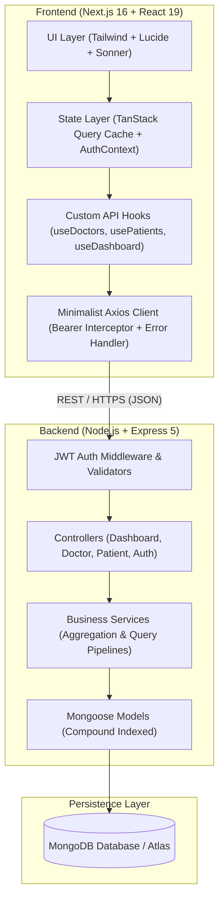

# Doctor Tracker — Administrative Healthcare Portal

## 1. Description
Doctor Tracker is a high-performance, secure administrative healthcare platform engineered with Next.js, Node.js/Express, and MongoDB to streamline physician oversight, department workloads, and patient allocation lifecycles. Purpose-built for hospital administrators, it combines real-time data aggregation, compound-indexed database queries, responsive visualizations, and strict JWT route protection to deliver sub-second data synchronization and modern clinical management.

---

## 2. Setup Guide

### Prerequisites
- **Node.js**: v18.0.0 or higher
- **npm**: v9.0.0 or higher
- **MongoDB**: Local MongoDB instance (v6.0+) or MongoDB Atlas cluster connection string

### Step-by-Step Installation

#### 1. Clone the Repository
```bash
git clone <repository-url>
cd my-app
```

#### 2. Backend Environment Setup
Create a `.env` file inside `backend/` by copying `backend/.env.example`:
```bash
cd backend
cp .env.example .env
```
Ensure your `backend/.env` has the following variables:
```env
PORT=5000
NODE_ENV=development
MONGODB_URI=mongodb+srv://<username>:<password>@cluster.mongodb.net/doctor_tracker?retryWrites=true&w=majority
JWT_ACCESS_SECRET=your_jwt_access_secret_key_minimum_32_characters
JWT_REFRESH_SECRET=your_jwt_refresh_secret_key_minimum_32_characters
JWT_ACCESS_EXPIRES_IN=15m
JWT_REFRESH_EXPIRES_IN=7d
CLIENT_URL=http://localhost:3000
```

#### 3. Install Backend Dependencies & Seed Database
```bash
npm install
npm run seed
```
> The seed script will initialize the database with credentialed admin accounts, specialty physicians, and patient records.

#### 4. Start the Backend Server
```bash
npm run dev
# Server starts on http://localhost:5000
```

#### 5. Frontend Environment Setup
In a new terminal window, navigate to the `frontend/` directory:
```bash
cd ../frontend
cp .env.example .env.local
```
Ensure your `frontend/.env.local` contains:
```env
NEXT_PUBLIC_API_URL=http://localhost:5000
```

#### 6. Install Frontend Dependencies & Start Next.js App
```bash
npm install
npm run dev
# Next.js client starts on http://localhost:3000
```

### Demo Credentials
- **Portal URL**: `http://localhost:3000/auth/login`
- **Email**: `admin@doctortracker.health`
- **Password**: `admin123`

---

## 3. System Architecture

Doctor Tracker employs a decoupled client-server architecture with strict layered separation between presentation, state management, REST services, and database persistence.



### Data Flow & Service Interactions
1. **Authentication Guard**: Unauthenticated users attempting to access protected routes (`/dashboard`, `/doctors`, `/patients`) are intercepted by Next.js `AuthContext` and redirected to `/auth/login`.
2. **Layered Data Fetching**: UI components consume domain hooks (e.g., `useGetDoctors()`, `useGetPatients()`), which call typed service endpoints (`doctor.services.ts`) through a centralized Axios client.
3. **Optimistic & Cache-First Mutations**: Creating, editing, or deleting doctors and patients triggers TanStack Query mutations that immediately invalidate relevant query keys (`["doctors"]`, `["patients"]`, `["dashboard-analytics"]`), causing a seamless, synchronized UI update with zero manual page refreshing.
4. **Single-Pass Aggregation**: Analytics requests hit a single multi-facet pipeline (`$facet`) in `dashboard.service.js`, computing summary counts, 30-day activity, workload ratios, and date trends simultaneously.

---

## 4. Technical Decisions

### Decision 1: TanStack Query + Layered Services Architecture over Raw `useEffect` / Redux
* **Context**: The application requires real-time synchronization between global counts (sidebar badges), dashboard visual charts, doctors tables, and patient modals upon every CRUD mutation.
* **Why TanStack Query**:
  1. **Zero Boilerplate State**: Eliminates redundant Redux reducers, actions, and dispatchers for asynchronous server state.
  2. **Automatic Query Invalidation & Deduplication**: Multiple components consuming `/api/dashboard/analytics` share the same in-memory cache without duplicate network hits.
  3. **Strict Layering**: Separating concerns into `services/` (pure network requests), `hooks/api/` (query lifecycles and cache invalidations), and `components/` (pure rendering) makes the codebase maintainable, testable, and compliant with enterprise standards.

### Decision 2: Single-Pass MongoDB `$facet` Aggregation & Compound Indexing over Multiple Endpoint Queries
* **Context**: The admin dashboard requires total doctor counts, total patient counts, 30-day recent registration counts, doctor-to-patient allocation ratios, and date-based registration trendlines.
* **Why `$facet` & Compound Indexing**:
  1. **Latency Reduction**: Instead of issuing 5–6 independent database round-trips from the frontend, the backend executes one optimized aggregation pipeline (`$facet`).
  2. **Compound Index Coverage**: Indexes like `{ specialization: 1, hospital: 1, createdAt: -1 }` on Doctors and `{ doctor: 1, createdAt: -1 }` on Patients ensure that filtering, searching, and pagination avoid full collection scans (`COLLSCAN`), providing fast query execution at scale.

---

## 5. Visual Evidence

| View | Description | Key Elements Verified |
|---|---|---|
| **Admin Dashboard (Desktop)** | Visual analytics & operational overview | Real-time Stat Cards, Patients Per Doctor utilization chart, Date-based registration trends, Live synced recent lists |
| **Doctors Management (Desktop)** | Physician directory & patient allocation modal | Search by name/email/hospital, Specialization and date filter, "View Patients" drawer, Add patient under doctor |
| **Patients Management (Desktop)** | Central patient registry & intake workflow | Dedicated `/patients` view, Condition filtering, Inline edit patient modal, Delete confirmation, "Register Patient" |
| **Responsive Mobile Layout** | Collapsible slide-over drawer on mobile devices | Fixed touch navigation, full-width data tables with horizontal scroll containers, hamburger toggle |

---

## 6. Project Checklist & Evaluation Alignment

- [x] **Secure Authentication**: JWT with Bearer header and expiration handling.
- [x] **Doctor Management**: Create, list, search, filter date-wise/specialization/hospital, view/add/delete assigned patients.
- [x] **Patient Management**: Dedicated page, list, edit, delete, search, filter by condition/date, pagination.
- [x] **Dashboard Visualizations**: Metric cards, doctor workload distribution chart, SVG date trends.
- [x] **Performance Optimization**: MongoDB compound indexes, lean queries, pagination metadata, memoized components.
- [x] **Code Quality**: Zero mock data, strict TypeScript types, 100% clean Next.js build.

